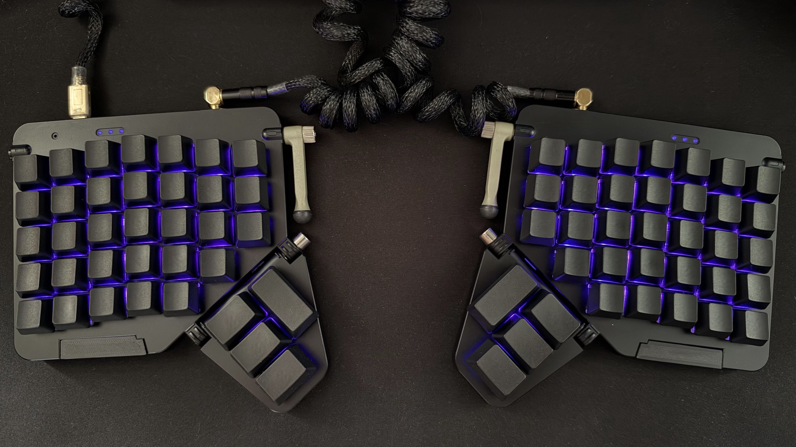
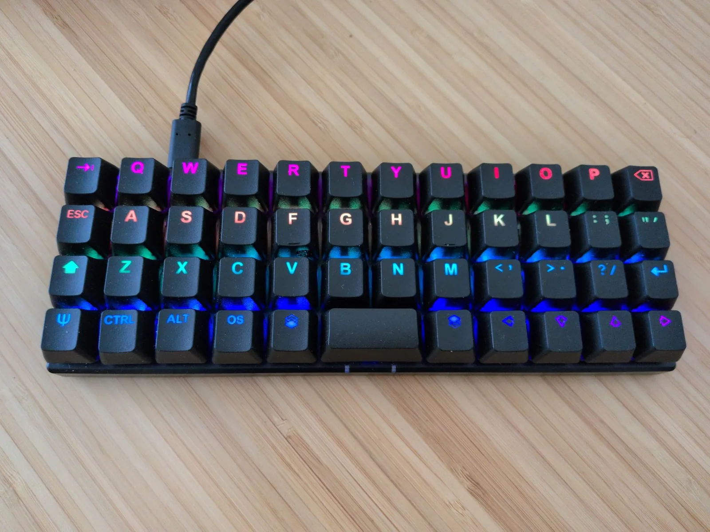

```sh
cd keyboards/k03
cargo build --release --bin central --bin peripheral
```

Build every K:04 Series configuration with:

```sh
./scripts/build_k04_matrix.sh
```

Production targets are defined in
[`.github/workflows/build.yml`](.github/workflows/build.yml). Shared firmware
rules are documented in
[`docs/ergohaven-firmware-profile.md`](docs/ergohaven-firmware-profile.md).

## Flash

1. Double-tap reset to enter the bootloader.
2. Copy the correct `.uf2` file to the mounted USB drive.
3. Flash both halves of a standalone split, or the Qube dongle and both halves
   of a Qube configuration.

## Reset and Migration

Use `settings_reset.uf2` for keyboard halves, or `settings_reset_qube.uf2` for
a Qube dongle. Re-flash the normal firmware after the reset.

The one-time `storage_migrate` utilities preserve settings from older
non-K:04 firmware. Upgrade details and the Velvet exception are documented in
the [firmware profile](docs/ergohaven-firmware-profile.md#storage-and-reset).

## Checks

```sh
./scripts/check_ergohaven_profile.sh
./scripts/test_all.sh
```

GitHub Actions validates production profiles and builds all supported devices
on every push and pull request.


## [User Documentation](https://rmk.rs/docs/user_guide/guide_overview) | [API Reference](https://docs.rs/rmk/latest/rmk/) | [FAQs](https://rmk.rs/docs/getting_started/faq) | [Changelog](https://github.com/rmk-rs/rmk/blob/main/rmk/CHANGELOG.md)

## Real-World Implementations

| [rmk-ble-keyboard](https://github.com/rmk-rs/rmk-ble-keyboard) | [dactyl-lynx-rmk](https://github.com/whitelynx/dactyl-lynx-rmk) | [sessile](https://github.com/willpuckett/sessile) |
| --- | --- | --- |
|  |  |  |

| [moonlander-rmk-1](https://github.com/MrFixThis/moonlander-rmk-1) | [rmk-zsa-planck-ez](https://github.com/atvari-eu/rmk-zsa-planck-ez) | [rmk-zsa-voyager](https://github.com/jpds/rmk-zsa-voyager) |
| --- | --- | --- |
|  |  |  |

| [Urchin](https://github.com/TimoBbz/urchin-rmk-firmware) |[zx66](https://github.com/zongxin1993/zx66-keybord) | [Lunakbd](https://github.com/gbPagano/lunakbd) |
| --- | --- | --- |
|  |  |  |

## Getting Started

### Option 1: Start with a Template

Quickly bootstrap your project using [rmkit](https://github.com/rmk-rs/rmkit) and the official RMK [project template](https://github.com/rmk-rs/rmk-template).

```shell
cargo install rmkit flip-link
# If you encounter installation issues on Windows, try this alternative command:
# powershell -ExecutionPolicy ByPass -c "irm https://github.com/rmk-rs/rmkit/releases/latest/download/rmkit-installer.ps1 | iex"
rmkit init
```